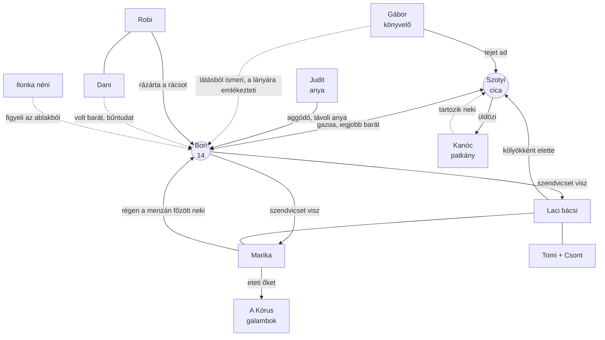

# Kapcsolatok

## Kapcsolati háló

Folytonos vonal: aktív, ismert kapcsolat. Szaggatott: rejtett, egyoldalú vagy a játék során alakul ki.

## Kapcsolati mátrix

Ki mit tud Boriról ezen az estén, és mit ad Szotyinak.

| Szereplő | Kapcsolat Borival | Kapcsolat Szotyival | Mit tud | Mit ad Szotyinak | Mit kér cserébe |
|---|---|---|---|---|---|
| **Ilonka néni** | szomszéd, figyelő | időnként eteti | Bori nem jött haza | egy falatot, megerősítést | — |
| **Robi, Dani** | rázárták a rácsot / volt barát | nem ismerik | pontosan, hol van | kihallgatott nyomot: „lent van” | — |
| **Gábor** | látásból ismeri | most találkoznak | semmit | tejet; a fináléban zseblámpát, telefont | bizalom (dorombolás, odavezetés) |
| **Marika** | Bori eteti őt, régen fordítva | ismeri Szotyit | látta Borit a tér felé menni | irányt, kenyeret a galambokhoz | — |
| **Laci bácsi** | hálás neki | „Kis Ördög”, ő nevelte | ismeri a régi alagutakat | ha odavezetik: utat a föld alá, erőt a rácshoz | — |
| **Tomi + Csont** | ismeri látásból | Csont ijesztő → barát | — | Csont szaga elriasztja a pincekutyákat (opcionális) | Csont elgurult labdája (mellékfeladat) |
| **A Kórus** | látták felülről | gyanakodnak rá | Bori lement a Csillag tér alá | a helyet | egy darab kenyér |
| **Kanóc** | nem érdekli | ellenség → adós | a csatornán át vezető utat | az utat az állomásig | hogy elengedjék / megmentsék |

## Kapcsolati ívek a játék alatt

| Kapcsolat | Kezdet | Vég |
|---|---|---|
| Szotyi ↔ Kanóc | vadász és zsákmány | kölcsönös tisztelet, adósság megadva |
| Szotyi ↔ Csont | félelem | barátság |
| Szotyi ↔ Gábor | idegen ad egy kis tejet | Gábor követi a föld alá |
| Bori ↔ Judit | veszekedés telefonon | ölelés a kórházban, Judit megtudja, ki segített |
| Bori ↔ Dani | eltávolodott volt barátok | Dani bevallja (ha az ő befejezése) |
| Bori ↔ az aluljáró | titkos szendvicsek | nyílt barátság, a lakótelep tudomást vesz róluk |

## Rejtett összefüggések (a játékos lassan rakja össze)

- Szotyi az aluljáróban született — Laci ismeri, Bori onnan vitte el. Szotyi „hazatér” oda, ahol
  született.
- Marika Bori iskolájában főzött — ezért ismerik egymást, és ezért hord Bori szendvicset.
- Gábor ablaka Boriék ablakával szemben van — évek óta látja a sárga kabátos lányt és a cicát
  a párkányon, de sosem köszöntek egymásnak.
- Laci a gyárban a metróépítés gépeit szerelte — ezért ismeri az állomás vészkijáratát.
