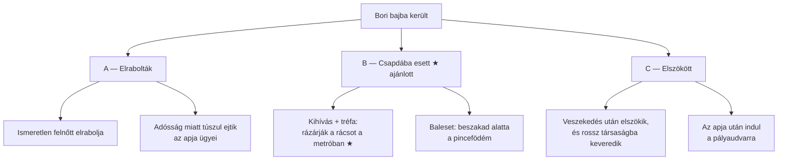
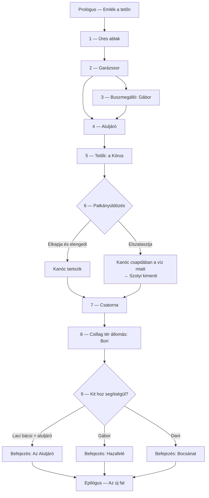

# Narratíva

Két fa van:

1. **Design-fa** — a központi rejtély változatai, amelyek közül Veronika választ (mi történt Borival?).
2. **Játékos-fa** — a kiválasztott (ajánlott) változat fejezetei, elágazásai és befejezései.

---

## 1. Design-fa: mi történt Borival? ✅ (a keret) / ❓ (a változat)

✅ A cica a 12–16 éves gazdáját keresi, akivel baj történt — elrabolták vagy bajba keveredett.

| Változat | Előny | Hátrány |
|---|---|---|
| **A — Elrabolták** | Erős tét, egyértelmű gonosz | Sötét, nehéz hangvétel egy kamaszlánynál; a cica ereje kevés egy emberrablóval szemben |
| **B — Csapdába esett** ★ | Valódi veszély (víz, sérülés), de nincs gonosz; jól illik a „láthatatlan emberek segítenek” témához; a cica természetes megoldása: **segítséget hoz** | Kisebb tét, mint egy elrablás |
| **C — Elszökött** | Erős érzelmi mag (apa-hiány, anya-konfliktus) | Kevesebb külső fenyegetés; a megmentés inkább érzelmi |

**Ajánlott: B1, C elemeivel.** Bori összeveszett az anyjával (érzelmi mag C-ből), dacból lement a
lezárt metróba befejezni a falfestményét a Kapucnisok kihívására, akik tréfából rázárták a rácsot
(B1). A veszélyt a sérülés, a hideg és az emelkedő víz adja, nem egy gonosz.

---

## 2. Játékos-fa (a B1 változatra)

### Áttekintés

A struktúra **„gyöngysor”**: a fő út lineáris, a fejezetekben vannak opcionális mellékszálak, és a
végén a játékos döntései (kivel épített bizalmat) határozzák meg, ki jön a segítségére. **Nincs
rossz befejezés** — mindegyikben megmenekül Bori; az különbözik, hogy kik és hogyan.

### Fejezetek

#### Prológus — Emlék a tetőn
*Egy héttel korábban, napnyugta, még nem esik.* Bori és Szotyi a 7-es panel tetején. Bori
fújja a cicajelét egy kéményre, és elmeséli Szotyinak a titkos falfestményét a „metróban”.
- **Játék:** mozgás- és ugrástutorial a tetőn, Bori után kell menni.
- **Célja:** megismertetni a lányt, a cicajelet (sárga, nyíl) és elültetni: „a metró”.

#### 1 — Üres ablak
*20:00, szitáló eső.* Szotyi az ablakpárkányon vár. Judit telefonál („Akkor Rékáéknál alszol? Jó.
Holnap beszélünk.”) — nem tudja, hogy Bori nincs Rékáéknál. Elmegy műszakba, és bezárja az ajtót.
- **Játék:** a lakás felfedezése, Bori nyomai (szétdobált festékszórók, egy hiányzó sárga
  festék). Kijutás a résnyire nyitott ablakon → erkélyek → ereszcsatorna.
- **Opcionális:** Ilonka néni ablaka — egy falat és a megerősítés: „a Kertész lány nem jött vissza”.

#### 2 — Garázssor
*20:40.* Az első friss cicajel. A garázsban a Kapucnisok.
- **Játék:** garázstetős platformszakasz; kihallgatás a tetőről. Robi: „Majd kijön, ha megunja.”
  Dani: „És ha nem tud?” Szotyi most már tudja: Bori nem önszántából van távol.
- **Opcionális:** Szotyi ellopja Dani kulcstartóját (Bori rajzolta) → ez kell a „Bocsánat”
  befejezéshez, hogy Dani felismerje a cicát.

#### 3 — Buszmegálló: Gábor ✅
*21:15.* Gábor az utolsó busszal jön haza, a megállóban áll esőben, egy cigarettát forgat.
- **Játék:** Szotyi nyávog, odadörgölőzik → Gábor leguggol, és a tejéből ad egy kupaknyit egy
  műanyag kupakban. ✅ Ha Szotyi marad, dorombol, és elkíséri a kapuig → **bizalom: Gábor**.
- Gábor mondata: „Te vagy a sárga kabátos lány cicája, ugye? A szemközti házból.”

#### 4 — Aluljáró ✅
*22:00, erősödik az eső.* Tűz, rádió, a hajléktalanok.
- **Játék:** Csont megugatja Szotyit → menekülés, majd megközelítés. Marika felismeri Szotyit: „Ez a
  kis festő macskája!” Elmondja, hogy látta Borit a tér felé menni. Laci felismeri a csonka fület:
  „Kis Ördög… hazajöttél?”
- **Opcionális:** Csont labdájának visszaszerzése → **bizalom: aluljáró**, és Csont elkíséri egy
  darabon.
- **Jutalom:** Marikától egy darab kenyér (a galambokhoz).

#### 5 — Tetők: a Kórus
*23:00.* A legnagyobb platformszakasz, a panel-tetőkön át a galambdúcig.
- **Játék:** a kenyérért cserébe a galambok elárulják: „Lement! Lement a Csillag alá! A rács, a
  rács — bezárták!” A tetőről látszik a Csillag tér lejárata — de a rács zárva, Szotyi nem fér be.
  A galambok: „Kérdezd a patkányt. A patkányok mindenhova bejutnak.”

#### 6 — Patkányüldözés ✅
*0:00.* A piac pincéi. Szotyi megtalálja Kanócot.
- **Játék:** az egyetlen igazi ügyességi szekvencia ✅ — üldözés csövek, ládák, szűk rések között.
- **Elágazás:**
  - **Elkapja** → Kanóc alkudozik az életéért. Ha Szotyi elengedi: tartozás. (Ha Szotyi nem engedi el,
    a játék nem engedi tovább — a cica csak „játszik” vele, aztán elengedi; nincs gonosz döntés.)
  - **Elszalasztja** → nem kudarc: Szotyi továbbkeres, és Kanócot egy elárasztott pinceaknában
    találja, csapdában. Kimenti → tartozás.
- Mindkét ág ugyanoda vezet ✅: a patkány később segít megtalálni a lányt.

#### 7 — Csatorna ❓ („Fúlcsort”?)
*1:00, felhőszakadás.* Kanóc vezeti Szotyit a főcsatornán át. Sötét, csak Kanóc hangja és a víz.
- **Játék:** lopakodó, csendes szakasz; a víz emelkedik, időnyomás nélkül, de érezhetően.
  Kanóc mesél a „nagyok világáról”, és miért nem szereti az embereket.
- Kanóc a végén: „Innen egyedül mész, szőrös. Ott lent a lányod. És tartozásom megadva.”

#### 8 — Csillag tér állomás
*2:00.* A befejezetlen peron. Bori nagy, sárga cicafestménye a falon. Bori egy akna alján, a
bokája kificamodott, fázik, a telefonja lemerült, a víz már bokáig ér.
- **Játék:** az érzelmi csúcspont. Bori meglátja Szotyit, sír és nevet. „Te hülye macska… Hogy
  jutottál ide?” Szotyi nem tudja kihúzni. Bori: „Hozz valakit. Bárkit. Kérlek.”
- Szotyi fogja Bori **sárga fülhallgatóját / festékszóróját** — egy tárgy, amit felvisz bizonyítéknak.

#### 9 — Segítséghívás (döntési pont)
*3:00.* Szotyi visszarohan a felszínre egy rövidebb úton (Kanóc mutatta). Akit odavisz, az jön
— **amelyik szereplővel bizalmat épített**. Ha többel is, a játékos választ.

### Befejezések

| Befejezés | Feltétel | Mi történik | Téma |
|---|---|---|---|
| **Az Aluljáró** | bizalom: aluljáró (Csont labdája) | Szotyi Bori tárgyát Lacinak viszi. Laci ismeri a gyári vészkijáratot; Tomi és Csont jön vele, Marika felrázza a környéket. Laci a csavarhúzójával kinyitja a régi rácsot. Ők viszik fel Borit. | A láthatatlan emberek mentik meg |
| **Hazafelé** | bizalom: Gábor (tej + elkísérés) | Szotyi Gábor ablaka alatt nyávog, amíg az le nem jön. Gábor zseblámpával követi a cicát, és hívja a mentőket — életében először csinál valami bátrat. | A magányos ember, aki végre lép |
| **Bocsánat** | Dani kulcstartója | Szotyi Dani elé ejti a kulcstartót. Dani megérti, felébreszti a többieket, és bevallják, hol a lány. Robi nyitja ki a rácsot, amit ő zárt be. | Felelősségvállalás |
| **Alap** | egyik sem | Szotyi a buszmegálló melletti telefonfülkénél / Ilonka néni ablakánál addig nyávog, amíg Ilonka néni hívja a rendőrséget. | — (biztonsági háló, hogy nincs kudarc) |

### Epilógus — Az új fal
*Egy hét múlva, napsütés.* Bori bekötött bokával, Judit mellette. A lakótelep egyik tűzfalán
új, nagy falfestmény: egy szürke cica egy sárga lánnyal, körülöttük — a befejezéstől függően —
a hajléktalanok, Gábor vagy a fiúk. Bori ezúttal nem éjjel, titokban festi, hanem nappal, és
nézik. Szotyi a párkányon alszik.

---

## Nyitott kérdések

- ❓ Elfogadja-e Veronika a B1 változatot (csapda, nincs gonosz), vagy sötétebb (A) kell?
- ❓ Több befejezés kell, vagy egyetlen, lineáris út?
- ❓ Mi a „Fúlcsort” — a csatorna-fejezet, vagy egy tárgy, amit a patkány ad?
- ❓ Gábor családja: mit mondott pontosan Veronika?
- ❓ Hossz: hány fejezet fér egy browser-játékba? (Rövid változat: Prológus, 1, 4, 6, 8, 9.)
